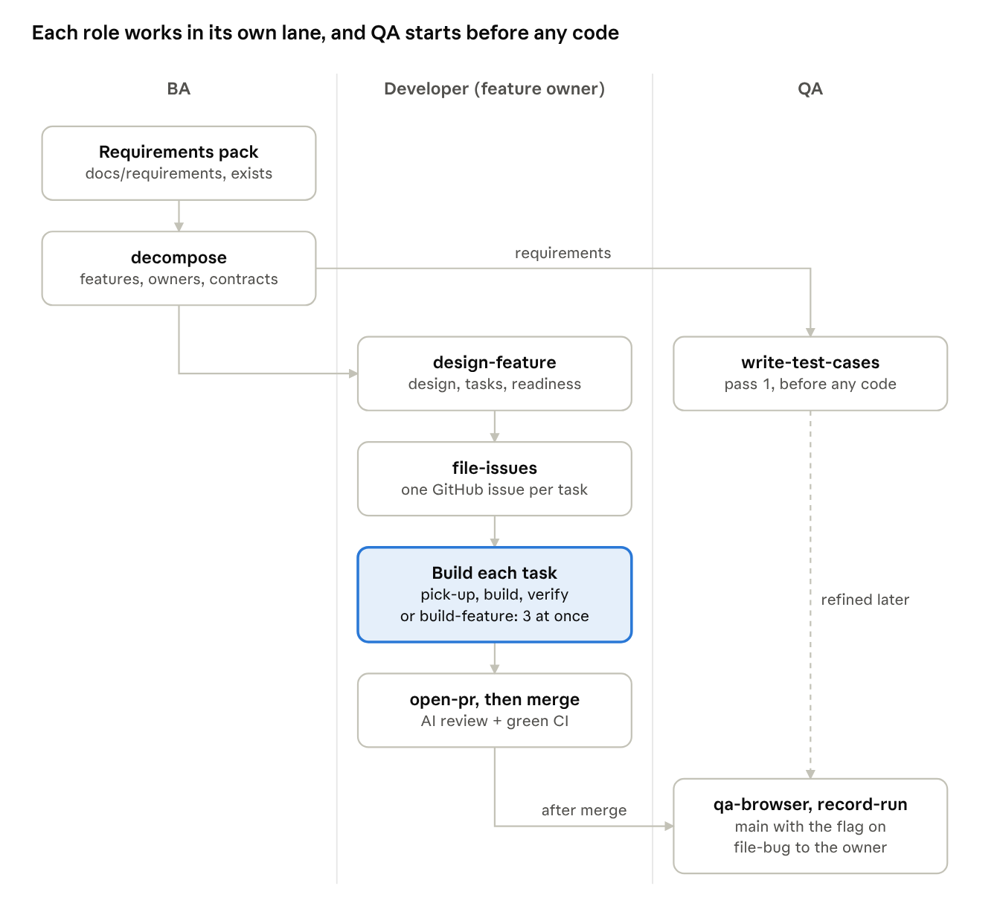

# scrimpify-sdlc: what it is and what we're building

> As of 2026-11-23. A team-facing overview; the binding spec is [`design.md`](design.md) and the build plan is in [`superpowers/plans/`](superpowers/plans/).

scrimpify-sdlc is a Claude Code plugin that gives the Cowos team one shared way of working with Claude, from a requirement to a merged pull request, built so that each developer and tester can work without waiting on anyone else.

## What it is and why

Cowos goes from a finished requirements pack to code, built mostly by Claude Code, on a tight launch timeline. Four people will use Claude every day. Without a shared process, each of us gets a different Claude: different plans, different test habits, and PRs nobody can trace back to a story.

scrimpify-sdlc fixes that. It is a **Claude Code plugin**: a folder of markdown instructions (skills), two helper agents, and small bash scripts (hooks) that Claude Code loads in our repo. It is not a server, a website or a SaaS product. There is nothing to deploy or pay for; it runs inside Claude Code on each person's laptop.

What it gives us:

- **One workflow for everyone:** requirement → feature → task issue → plan → test-first build → independent review → PR → merge.
- **Independence:** each developer owns whole features and each tester works from the requirements, so nobody waits on anyone else.
- **Parallel work:** one developer can have several Claude subagents building tasks of their feature at the same time.
- **Traceability:** every change links back to an issue, a plan and a review record.
- **Safety rails:** Claude cannot edit on `main`, cannot push or post to GitHub without a person saying yes, and cannot read credential files.

It starts with Cowos, and any other Scrimpify repo on GitHub can adopt it the same way. It replaces gstack for Cowos work; gstack can stay installed but nothing depends on it.

## Who uses it

Everyone on the team works inside Claude Code, each with skills built for their role. The design holds for more than two developers.

| Role | People | Uses Claude for | Main skills |
| --- | --- | --- | --- |
| BA | 1 | Turning the product owner's asks into requirements and features, keeping `docs/requirements/` current, handling change requests | `shape`, `decompose`, `change-request`, `create-issue` |
| Developer | 2 | Designing their feature, filing its tasks, planning and building test-first, reviewing, opening PRs, answering PR feedback | `design-feature`, `file-issues`, `pick-up`, `build`, `verify`, `open-pr`, `build-feature` |
| QA | 1 | Writing test cases from the requirements before code exists, testing in a real browser, recording runs, filing bugs | `write-test-cases`, `qa-browser`, `review-ui`, `record-run`, `file-bug` |

QA writes automated Playwright tests through the developer flow, like any other code change.

## How we stay independent

Independence is designed in when features are planned, then protected by hooks and CI. The one honest limit: a **foundation feature (F00)** with tenancy, auth, the solution skeleton and CI must land first, because everything stands on it. After that, features run side by side.

1. **Features are vertical slices with one owner.** Each feature is something a user can do end to end (database → API → screen → test), that QA can test on its own, and that maps onto Cowos modules (`Inventory`, `Booking`, `Payments`, `Sites`…). One developer owns it from design to merge.
2. **Every path has a class.**
    - *Owned:* the feature lists the folders it owns (`owns:`). No two active features own the same path.
    - *Shared, add-only:* registration points every feature touches (module registration, routes, feature flags, architecture-test rules, migrations). A feature only adds its own file or lines. Each module gets its own database context and migrations folder, so two features never edit the same file.
    - *Shared, guarded:* solution files, shared UI packages, CI config, contracts. Changed only through `change-contract`.
    - *Generated:* the API client, the roadmap tables and the test coverage table are generated, so nobody hand-edits a shared table.
3. **Contracts first, as code.** Anything crossing a feature boundary (endpoints, events, module interfaces, table ownership) is written down in `docs/contracts/` **and** as code: the interface, an in-memory fake, and a contract test. The provider's owner merges that first. Consumers build against the fake and can merge behind their feature flag while the provider is still unbuilt; the real implementation takes over automatically when it lands.
4. **Ownership lasts while a feature is active.** A finished feature releases its folders; the next feature that extends that module claims what it needs. Ownership is enforced by a generated GitHub `CODEOWNERS` file.
5. **Hooks keep work in its lane.** Editing another feature's folders asks you first (and is blocked for subagents). Each developer works in their own clone, each task in its own git worktree, each test run against its own throwaway database and test tenant.
6. **Merging never breaks a neighbour.** Unfinished screens stay behind a feature flag. Every PR runs every module's unit and integration tests and every contract test. Whoever breaks another feature's tests fixes it; if `main` goes red, anyone may revert the merge that caused it.
7. **QA and the BA work independently too.** QA writes test cases from the requirements before any code exists, and tests `main` with the feature's flag on for a QA test tenant. The BA can re-generate one feature's requirements without touching others; a change that would alter a contract goes through `change-contract`.

The only QA work that waits is a case spanning two features (for example booking a seat on a seat map), which runs once both have merged.

## The workflow at a glance



Planning flows from the BA to the feature owner; QA writes test cases from the requirements in parallel and tests each feature on `main` once it merges.

## The skills

There are 22 skills, each typed as `/scrimpify-sdlc:<name>` (or picked by Claude from a plain-English request).

| Skill | Stage | Who | What it does | Asks you before |
| --- | --- | --- | --- | --- |
| `shape` | Planning | Anyone | Turns a raw idea into a problem, outcome and success measure, with scope and open questions | Nothing |
| `decompose` | Planning | BA + a developer | Requirements pack → roadmap, master test plan, one `requirements.md` per feature, first contracts; F00 first; can re-generate one feature alone | Merging its PR |
| `design-feature` | Planning | Feature owner | Writes the feature's design, decisions, contracts, task list with readiness, task bodies | Merging its PR |
| `review-design` | Planning | Anyone | Fresh reviewer on a design, roadmap or contract: scope fit, architecture, user experience | Which findings to fix |
| `file-issues` | Planning | Feature owner | Files a merged feature's tasks as GitHub issues in one preview | One confirmation |
| `create-issue` | Planning | Anyone | A one-off story, task or contract issue in the house format | The issue |
| `change-request` | Planning | BA | Applies a product change to one feature: requirements, issues, test cases; flags merged work that no longer fits | Issue writes |
| `change-contract` | Planning | Developer | Proposes a contract change, lists every affected feature, asks their owners to review | Push + PR |
| `pick-up` | Build | Developer | Loads an issue, checks the code, writes `plan.md`, gets it reviewed | **Plan approval** |
| `build` | Build | Developer | One acceptance criterion at a time: failing test first, then code | Only if the plan must change |
| `verify` | Build | Developer | Runs checks, then three fresh reviews in parallel (design, test bite, code review); fixes | Which findings to fix |
| `open-pr` | Build | Anyone | Checks the exit list, drafts the PR, pushes and opens it; docs mode for BA/QA | **Push + PR** |
| `fix-review` | Build | Developer | Handles PR comments and failing CI in one pass | Push + replies |
| `update-issue` | Build | Developer | Reflects a mid-work scope change into the issue and plan | The issue write |
| `investigate` | Build | Anyone | Reproduces a bug, finds the root cause with evidence, proposes the fix | Nothing (the fix has its own gates) |
| `build-feature` | Parallel build | Feature owner | Runs several task subagents at once on one feature | **Build plan, once** + push gates |
| `verify-feature` | Parallel build | Feature owner | Checks finished tasks fit together and meet the feature design | Nothing |
| `write-test-cases` | QA | QA | Test cases from requirements (before code), refined after build; coverage table | Any issues filed |
| `qa-browser` | QA | QA | Walks the cases in a real browser with Playwright; screenshots; run record | Bugs to file |
| `review-ui` | QA | QA | Checks screens against design tokens and runs accessibility checks | Issues to file |
| `record-run` | QA | QA | Records a manual test run and rolls up results | Bugs to file |
| `file-bug` | QA | QA | Files a bug with repro steps; checks for duplicates; assigns the feature owner | The issue |

## Building a feature in parallel

With `/scrimpify-sdlc:build-feature`, one developer approves a build plan once, and Claude then builds up to three tasks of that feature at the same time.

1. The feature's design must be merged and its tasks filed as issues (it files any that are missing).
2. It writes `build.md`: the tasks, which can run side by side and which must wait for another, and the check-in milestones. **The developer approves it once.**
3. It starts one `task-builder` subagent per ready task, each in its own git worktree and branch. Each one plans, builds test-first and runs its own fresh reviews.
4. **Decision rule:** anything the design didn't settle stops only that task and comes to the developer in chat. Other tasks keep going. Silence is never treated as a yes.
5. As each task finishes, `verify-feature` checks it against its neighbours' contracts; at milestones and at the end it checks the whole feature.
6. **Push gate:** everything ready to leave the machine (branches, PRs, issue comments) is listed together and goes out on one yes. Dependent tasks get stacked PRs.
7. PR feedback goes back to the subagent that built the task. Running the skill again resumes from `build.md`.

Subagents can never push, open PRs, post on GitHub, use the git stash, remove worktrees, prune Docker, kill processes, install software or run infrastructure changes. Hooks block all of these for subagents.

## What is enforced

Our rule: a rule that matters is enforced by a hook or a CI check; anything left to a skill's instructions is a convention, and we say so.

**Hooks** (run inside Claude Code on every tool call, Windows and Linux):

| Hook | What it does |
| --- | --- |
| `session-start` | Loads the short team standard (under 8 KB) into every session; tells you when a plugin update exists |
| `guard-branch` | Blocks file edits on `main`/`master`; tells Claude to propose a branch name and confirm it |
| `guard-scope` | Asks before an edit in another feature's folders or a guarded shared file; blocks it for subagents |
| `guard-git` | Blocks pushing to `main`, force pushes and skipping git hooks; asks before any push, PR or issue write; blocks those for subagents |
| `guard-shared` | Stops subagents touching shared machine state (git stash, worktrees, Docker prune, killing processes, installs) |
| `guard-rails` | Blocks reading credential files and keys; asks before `terraform apply/destroy` and AWS changes |

**CI checks** (templates Cowos wires in F00; they bind once marked required in branch protection):

- **Review on record:** a code PR's `plan.md` ends with `Result: PASS` (docs-only PRs skip it).
- **Criteria coverage:** every acceptance criterion is named in a test, or recorded as an accepted test gap.
- **Owns overlap:** no two active features own the same folder; `CODEOWNERS` matches.
- **Add-only:** shared registration files only ever gain lines.
- **Lane report:** lists which lanes a PR touches (code-owner review does the blocking).
- **TODO has issue:** a new `TODO` must cite an issue number.
- **Tests changed:** flags source changes with no test changes (warning only).

**Honest limits:** hooks read command text, so a command assembled at run time can slip past them. They are a strong default, not a sandbox. Full browser tests run on staging after merge, so a break only they catch is found after merge, and it is filed against the feature whose merge caused it.

## Who approves what

People decide at a few points; everything between them is automated or batched. A PR that stays in your own feature's folders needs no second person.

| Stop | Who decides | How |
| --- | --- | --- |
| Decomposition, roadmap, first contracts | BA + developers | Merge the docs PR |
| Feature design | Feature owner, after the fresh design review passes | Merge the docs PR (others may comment) |
| Contract change | Every affected feature owner | Approve the `contract/` PR |
| Which issue to work on (by hand) | Developer | In chat |
| Task plan (by hand) | Developer | In chat, plan shown in full first |
| Build plan (parallel build) | Feature owner | In chat, once per feature |
| Open decisions (parallel build) | Feature owner | In chat; only that task waits |
| Push, PR, issue writes | Whoever runs the skill | One listed yes, with a permission prompt behind it |
| Code PR inside your own lane | Feature owner | Merge once the AI review is on record and checks are green |
| Code PR touching another lane, a contract or a shared file | That lane's owner | GitHub "require review from code owners" |

## Where things live in Cowos

Everything sits in the one Cowos monorepo; plans and code are reviewed together. The plugin adds the folders under `docs/` below.

```
Cowos/
├── CLAUDE.md                    project context, check commands, skill routing
├── .claude/settings.json        turns the plugin on for this repo
├── src/ · web/ · renderer/ · infra/ · tests/     code (layout settled in F00)
└── docs/
    ├── requirements/            INPUT: the BA's requirements pack (exists)
    ├── designs/                 INPUT: the approved product/tech design (exists)
    ├── product/
    │   ├── roadmap.md           features, owners, dependencies, status (tables generated)
    │   └── test-plan.md         master test plan and coverage (tables generated)
    ├── contracts/               one file per contract between features
    ├── features/
    │   └── f03-inventory/
    │       ├── requirements.md  what it delivers: owner, status, owned folders, dependencies
    │       ├── design.md        how it is built
    │       ├── decisions.md     each decision and the alternatives rejected
    │       ├── tasks.md         one line per task, with readiness
    │       ├── bodies/T001.md   one per task: story, criteria, dependencies
    │       ├── test-plan.md     QA's cases for this feature
    │       └── build.md         the parallel build's living plan
    ├── work/<year>/<issue>-<slug>/plan.md   one per task issue
    └── test-runs/<date>-<slug>.yaml          one per manual QA run
```

Conventions:

- One task = one GitHub issue = one PR. Branches: `41-product-pricing` for code, `docs/<slug>` for docs-only work (no issue needed), `contract/<slug>` for contract changes.
- Labels: `type:feature|task|bug|contract`, `feature:f03`, `area:api|admin|booking|website|ops|marketing|renderer|infra`, and readiness. Milestones are sprints.
- **Readiness** of a task: `ready:agent` (every criterion provable by a command), `ready:human` (a person must judge at least one criterion), `needs-detail` (refused until fixed). Rewriting a criterion just to make it agent-ready is not allowed.
- Every commit Claude writes carries `Co-Authored-By: Claude …` and `Scrimpify-SDLC: v<version>` trailers, so `git blame` shows what was AI-written.

## Out of scope

The plugin stops at a merged PR. These stay outside it:

- **Deploying:** staging deploys on merge and production after a manual approval happen in Cowos's own GitHub Actions pipeline. The plugin only makes Claude ask before running a deploy or infrastructure command from a laptop.
- **Other trackers:** GitHub Issues only; no Jira or Azure Boards.
- **Issues across several repos:** each product is one monorepo with one tracker.
- **Claude Code on the web (cloud sessions):** v1 supports the CLI and the desktop app.
- **Usage tracking:** none.
- **Re-planning the Cowos build plan:** that is the product owner's call (see the last section).

## Rolling it out in Cowos

Once v0.1.0 is published, adoption is one small Cowos PR and then the planning pass, all before sprint 0 so the foundation work already runs through the plugin.

1. **Turn the plugin on for the Cowos repo** (two `claude plugin … --scope project` commands, commit `.claude/settings.json`). Each teammate then says yes once when Claude Code offers to install it. Needs: Claude Code, GitHub access to the plugin repo, `gh` logged in, Git Bash on Windows.
2. **Update Cowos's `CLAUDE.md`:** remove the gstack routing; add the "Project checks" table (each area marked *not configured yet* until F00 creates it).
3. **Add five review checklists** taken from our NFRs: tenant isolation, payments/PCI, privacy/DPDP, module boundaries, billing reproducibility. Reviewers apply them whenever a change touches that area.
4. **Run `decompose`** on the requirements pack: roadmap with F00 Foundation first, the features, owners, dependencies and first contracts, with folder ownership left empty. Review and merge.
5. **F00's first task settles the folder layout**, including per-module, per-feature subfolders and the add-only registration points (the architecture doc and the build plan currently disagree on paths), and wires CI.
6. **`decompose --owns`** fills every feature's owned folders against the real layout in one PR.
7. **Features run in parallel**, each developer on their own feature, QA writing cases from the requirements alongside.

The repo owner also sets branch protection on `main`: required checks plus "require review from code owners".

## Where the build stands

The design and the 17-task build plan are approved; 3 of 17 tasks are done and reviewed, and task 4 is in its third round of fixes. Each task is built by a fresh Claude subagent and checked by an independent reviewer before the next one starts.

| # | Task | Status |
| --- | --- | --- |
| 1 | Repo skeleton, manifests, test harness | Done, reviewed |
| 2 | Hook library, the team standard, session start | Done, reviewed (2 fix rounds) |
| 3 | Branch guard | Done, reviewed |
| 4 | Git/GitHub guard | In fix round 3: PowerShell quoting, GraphQL writes inside `$(…)`, and a fail-safe for very complex commands |
| 5 | Shared-state guard and credentials/infra guard | Not started |
| 6 | Lane library and lane guard (the heart of independence) | Not started |
| 7 | Hook wiring | Not started |
| 8 | `CODEOWNERS` and table generators, lane CI checks | Not started |
| 9 | PR CI checks and workflow template | Not started |
| 10 | Reviewer and task-builder agents, review briefs | Not started |
| 11 | Templates and example checklists | Not started |
| 12 | Planning skills (8) | Not started |
| 13 | Build skills (7) | Not started |
| 14 | Parallel build skills (2) | Not started |
| 15 | QA skills (5) | Not started |
| 16 | Plugin CI, README | Not started |
| 17 | Proof on a sample two-feature project (incl. two tasks built in parallel), release v0.1.0, publish | Not started |

Task 4 is the slowest because it is a security guard that reads command text; its reviews have caught real bypasses (for example a heredoc with an apostrophe hiding a later `git push origin main`). The remaining hooks are simpler.

## Decisions needed

These come out of the plugin's design but are the team's and the product owner's to make.

- [ ] **Re-plan the build for 2 developers.** `14-build-plan.md` is staffed for 4 developers and a designer; the week-20 target and per-developer assignments need re-planning. `decompose`'s roadmap will show the real order.
- [ ] **Update the PR review rule.** The build plan says a second developer reviews every PR. The team decided: only PRs that cross into another feature's lane, a contract or a guarded shared file need another person; own-lane PRs merge on the AI review plus green checks.
- [ ] **Move to feature-based staffing.** The build plan assigns developers by layer (backend, admin screens, customer screens, platform). Independence needs each developer to own whole features instead.
- [ ] **Settle the folder layout in F00.** `08-architecture.md` and `14-build-plan.md` disagree (`src/` vs `api/`, `admin` vs `tenant-admin`). F00's first task picks one before any folder is created.
- [ ] **Set branch protection on `main`:** required checks plus "require review from code owners" (repo owner, in GitHub settings).
- [ ] **Accept the stated test gap:** full browser end-to-end tests run on staging after merge, not on every PR (they need the whole stack and Razorpay test mode).
